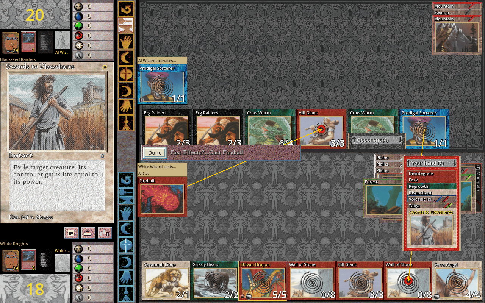
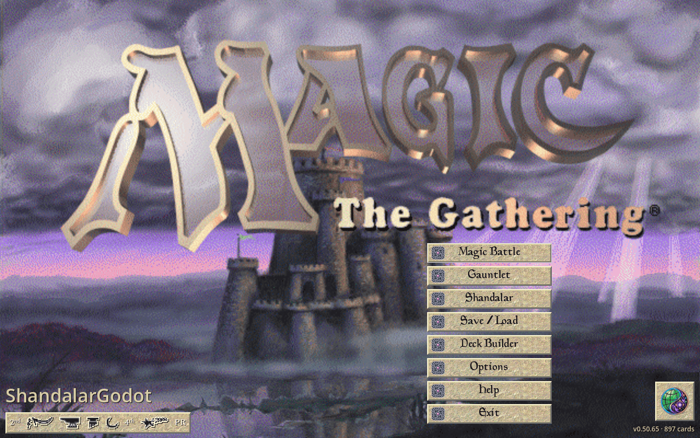
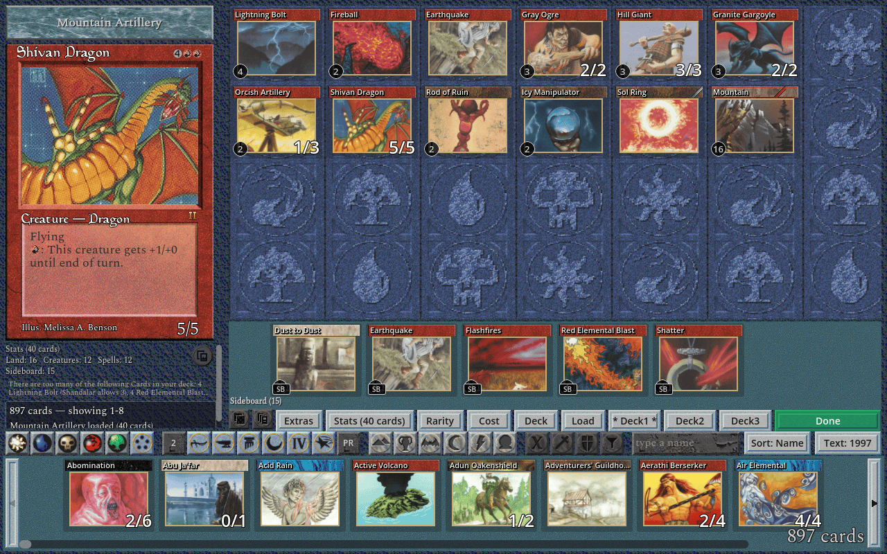
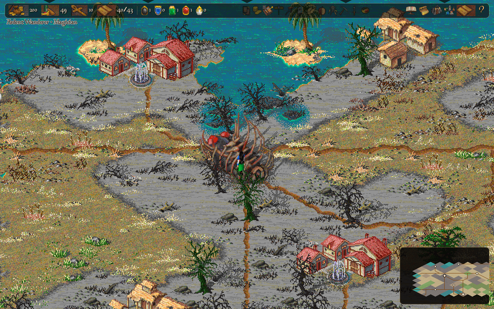
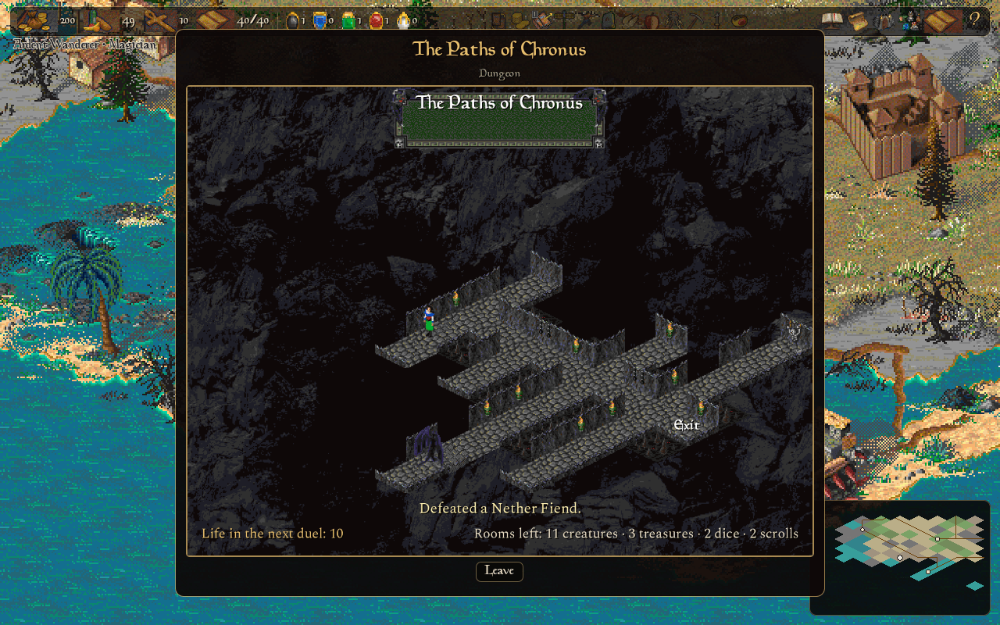

# ShandalarGodot

<p align="center">
  
</p>

> This project is a love letter to MicroProse MTG: to preserve that special
> 90s Shandalar feeling — the feel of playing early Magic, up to Fourth
> Edition, Alliances, and maybe Fifth — while still going for
> quality-of-life improvements, a modern spin on the gameplay, and the
> tools to go with it.
>
> The key is in the limitations. A specific, finite spell library is
> something you can get creative with, instead of losing time to an
> ever-widening card pool and its obsolescence. It can be fun, it can be
> creative, and — would you believe it? — it can even be relaxing. :)
>
> All the best to the players, and to the community for its help with the
> development. Good luck and good health to all!
>
> — b0realis

An open-source, from-scratch remake of MicroProse's 1997 *Magic: The
Gathering*, built in GDScript with Godot. Early Magic, a modern rules
engine, and the freedom to keep the game alive.

## Screenshots

<p align="center">
  
  <br>
  <em>A spell chain in progress during a duel.</em>
</p>

<p align="center">
  
  
  <br>
  <em>The main menu and the Deck Builder.</em>
</p>

<p align="center">
  
  
  <br>
  <em>The Shandalar adventure: the world, and a dungeon's board.</em>
</p>

<p align="center">
  <em>Every screenshot shows the optional original-game skin and card pictures.</em>
</p>

## Play

**Duels, deck building, optional expansions, Booster Draft and LAN play.**

Download the **[latest Shandalar release](https://github.com/b0realis/ShandalarGodot/releases/latest)**
for **Windows, Linux, Apple Silicon/Intel Mac, Raspberry Pi 5 ARM64 and web**.
New to it? **[Getting Started](https://b0realis.github.io/ShandalarGodot/)**
goes step by step from the download to your first duel, with card pictures
and every set up to Tempest.
Handheld test packages — Steam Deck, ArkOS, and the Meta Quest as a
sideloaded flat panel app — are built locally; see [docs/handhelds.md](docs/handhelds.md).
Choose a standalone or original-skin package; the release includes launch
instructions, a separate skin download and SHA-256 checksums. You can also
run the source with Godot 4.7 (below).

Play with an **897-card early-Magic core**, historic decks, four computer
opponents, local hotseat, Gauntlet, sealed decks and best-of matches with
sideboarding. Optional `Pack-1-DotP-complete.zip` finishes the eight set
checklists: its title-screen `1-tDotP` button can enable 373 additional set
entries, for **1,270 set entries / 901 unique rules identities**. The Deck Builder
supports large cards, live filters and keyboard browsing, **AutoDeck**, which
builds a deck from a set, a dealt pool or a pasted list to your wishes —
colours up to five, a gold deck, the rarity from pauper to rares only, classic
or non-classic lands, the Power Nine on or off, the variety between one seed
and the next — with its lands fitted to the curve and its basics to the pips,
and a Stats window that audits the mana base. The duel's keys are rebindable
under Options, Controls, and a controller's face buttons play beside the mouse.
Further optional packs
add **Fallen Empires, Ice Age, Homelands, Alliances, Portal, Portal Second Age,
Fifth Edition, the Mirage block** (Mirage, Visions, Weatherlight) **and the Tempest
block** (Tempest, Stronghold, Exodus), with engine and AI support.
The **Shandalar adventure** is in development: it can be played from the
source from Embark to the end — its world, towns, quests, lairs, roaming
creatures and sieges, the castles, the dungeons and the final battle — and
is being playtested; card packs in the adventure are not implemented yet. Public Internet
matchmaking remains future work.

Card artwork and constructed pack ZIPs are intentionally not release downloads.
Every platform package includes the Python builders and
[construction instructions](docs/card-art-and-packs.md); no source checkout is needed.

The [agent play guide](agentic-playgude-mtg.md) teaches MTG rules, fair-information
play, combat decisions and deck-building strategy without assuming a particular
automation interface. MCP clients can read it through `play_guide`, a chapter
at a time, or the `shandalar://play-guide` resource.

## LAN play and Booster Draft

The desktop release includes local-network duels and
[random-draw knockout tournaments](docs/sgmanalink-tournaments.md), including
up to **40 players**, configurable match lengths and deck policies, the
host's own table rules (starting life and the implemented rules forks),
an organiser's Master Panel, graphical advancement and final standings.
[Computer seats](docs/sgmanalink-computer-players.md) use the same four local
opponents and separate Unfair challenge; choose how many to add to a tournament.
Tables are open by default — the Game Browser lists every duel on the network
by name, with its deck rule (bring your own or the host's assigned deck), and
joins with a click; switch on **Invitation only** to admit only the players you
send the invitation to. Use matching builds and enabled card catalogues on all
participants.
Internet play, permanent accounts and MElo are parked for now.

The game also includes an in-game [Booster Draft](docs/booster-draft.md): choose
sets/cards, open random packs, and build against a countdown with automatic saves.
Find it under Options; no command-line launcher is needed.

## Magic Public Notation (MPN) — a proposal to the community

Every duel you play, on your own or on the LAN, can be saved as an `.mpn`
file: a plain-text public history of the game — everything both players could see, never a hidden hand or a
library's order. **Magic Public Notation** is our proposal for an open,
shared format for such records, independent of any one engine: reading one
takes a JSON parser and the specification's patch rules — not Godot, a
card database or a rules engine. Export
one at the end of a duel, open it under **Options → View past-played
games**, and **Watch duel** plays it back on the familiar table.

- [The MPN 0.1 specification](docs/mpn-specification.md) — the grammar, the
  public-information boundary, how to rebuild each state, and a
  conformance checklist for writers and readers.
- [The player guide](docs/mpn-v0.1.md) — recording, exporting and watching
  in ShandalarGodot, locally and on the LAN.
- [Example files](docs/mpn-examples/) to import and test against: four
  `.mpn` records — a short finished game, a recording stopped early and two
  whole duels — and, beside the two duels, their move lists as readable
  text (`.txt`).

MPN 0.1 is a draft, not an official Magic standard. If you build a Magic
engine, a replay viewer, a tournament tool or an archive, please read it,
try it, and tell us what it needs — open an
[issue](https://github.com/b0realis/ShandalarGodot/issues) with "MPN" in
the title. A second implementation is the best test a format can have.

## Philosophy

**The limitation is the feature.** Preserve the finite early-Magic pool
and the 1997 feeling. Optional additions should leave that core intact.

**Port, don't invent.** The original game's decisions guide the remake;
quality-of-life changes and rules simplifications are explicit. The
[source history](Provenance.md) and [fidelity ledger](docs/simplified-cards.md)
keep those choices open to inspection.

**Strong play. Fair information.** Apprentice, Magician, Sorcerer and Wizard
are **non-cheating** opponents: none of them reads your hidden hand, secret
library order or future draws. Each level plays more carefully than the one
below it, and Sorcerer and Wizard also study their own deck, plan their
spells and mana, and search combat ahead. Stronger difficulty means stronger
analysis, never free resources or special rules. See the
[fair-play contract](docs/fair-play.md).

## Art and skins

The game is playable with its built-in appearance. Choose a `-with-skin`
release for the original look and sounds, or add `original_skin.zip`
separately. Import packs through **Options → Skin**; on desktop they can
also live in `skin/` beside the game.

**Card pictures are not included in the repository or release downloads.**
Packages from 0.32.0 on for **all platforms** include the construction tools
and their required metadata in `tools/`, `cards/data/` and
`packaging/card_packs/`; no source checkout is needed. Older 0.20.0 downloads
do not include the numbered-pack builders. Use Python 3.10+ and run these
commands from the extracted game folder (Windows: use `py -3` for `python3`):

```sh
python3 tools/fetch_card_art.py --out cache/cardart
python3 tools/mtg_assets.py --from-cardart cache/cardart --out skin/cardart.zip
```

Run the ZIP command only after the download succeeds. This creates the base
card pictures. Numbered packs include their own set artwork; for example:

```sh
python3 tools/pack_3_ice_age.py fetch-art
python3 tools/pack_3_ice_age.py build cardpacks/Pack-3-Ice_Age.zip
python3 tools/pack_3_ice_age.py verify cardpacks/Pack-3-Ice_Age.zip
```

The [card artwork and pack guide](docs/card-art-and-packs.md) gives complete
commands for **Pack 1 (1-tDotP), Fallen Empires, Ice Age, Homelands,
Alliances, Portal, Second Age, Fifth Edition, the Mirage block and the Tempest block**, cache locations and platform-specific installation details.
It also ships as `CARD-ART-AND-PACKS.md` and is included in each package's README.

On desktop, keep `original_skin.zip` and `cardart.zip` in **`skin/`**, and
the exact-name `Pack-*.zip` files in **`cardpacks/`**, both beside the game
executable (beside `Shandalar.app` on Mac, never inside it). **Leave ZIPs
zipped.** Use **Options → Card Packs → Rescan**, then enable the packs.
The separate `packaging/card_packs/` directory is builder metadata, not an
installation folder. Completed packs and card art are never bundled in releases.

Web can import/fetch the skin and base cardart ZIPs into browser storage;
this build has no browser installation path for numbered gameplay packs.
Its included Python tools run on your computer and can build packs for desktop.

To rebuild the original skin from your own copy of the game:

```sh
python3 tools/mtg_assets.py --install /path/to/game
```

**The original skin requires only the original 1997 MicroProse game:**
its CD, or the folder you installed it to. Nothing from a later
re-release or another project is needed or read. The importer reads your
installation without changing it. The 1997 skin is the default, and the
only skin a release ever carries.

**No 1997 copy? A Manalink install as a backup.** The tool can also read
a later Manalink install, if you add `--manalink`. Each file the 1997 game
would give is then taken from Manalink's own where it fits the shape the
game draws (some are Manalink's restyles, and a few stay the game's own
drawing). This is only an option of the tool, for your own skin folder:
no release is built from a Manalink install or carries a Manalink skin,
and the release build refuses a skin folder the option wrote into.
`--check` lists every asset and where it would come from, and writes
nothing:

```sh
python3 tools/mtg_assets.py --check /path/to/manalink --manalink
python3 tools/mtg_assets.py --install /path/to/manalink --manalink
```

**A hi-res skin for big screens.** `tools/upscale_skin.py` makes a second
skin out of your 1997 one, `original_skin_realesrgan-anime_2x.zip`: the
same files under the same names, with every picture at twice the size and
the music, sounds, fonts and coin toss as they are. It runs Real-ESRGAN's
anime model, which is free and open source, then takes the colours back
from the 1997 picture, so the art gets sharper without changing its
colours. On Linux the tool fetches the upscaler once; it needs Pillow and
a Vulkan GPU driver. The hi-res skin is a skin like the 1997 one: choose it
in Options → Skin or drop it on the window, and it is worn from the next
start; choose the 1997 skin again to go back. The game draws each 2x
picture at the 1997 size, so the layout doesn't change and every picture is
sharper on a big screen. To mix, put a 1997 picture back into the hi-res
zip under its own name. A zip of 2x copies made by 0.50.28 is reused rather
than upscaled again with `--reuse`:

```sh
python3 tools/upscale_skin.py --skin original_skin.zip
python3 tools/upscale_skin.py --skin original_skin.zip --reuse old_2x.zip
```

See the [player-files guide](docs/player-files.md) for pack locations and the
[skin catalogue](docs/skin-catalogue.txt) for creating your own skin; the
[same catalogue as a table](docs/skin-catalogue.csv) lists every file of
the skin zip by name.
Card pictures stay personal—do not include them in a public web build.

## DeckLab CLI

The desktop releases include a headless deck-analysis tool: run
computer-versus-computer duels in parallel, compare matchups or gauntlets,
and study win rates, confidence intervals, charts and CSV/JSON reports.
Seeded runs make it useful for experimenting with decks and comparing ideas.

Run `./deck_lab.sh --help` on Linux/macOS or `.\deck_lab.bat --help`
on Windows. `--procs` and `--jobs` control parallel workers (a worker
that dies is replaced by a fresh one for the same slice of the run);
`--no-elo` keeps experiments out of the ratings ledger. A tournament —
one deck or a folder of decks, each played against the decks that are
known to be good — is `--field mine/ --gauntlet decks/ --group tournament`:
the field is ranked in `report.txt`, `standings.csv` and `top.txt`, and
`--group all` makes the gauntlet the whole deck library.
Beside it, `./auto_deck.sh --help` (`.\auto_deck.bat` on Windows) is the
AutoDeck tool as a command line: it builds a folder of seeded decks from
every combination of the switches you give it, and plays no game; its
`--packs` names the card packs the cards come from, and a field mined with
`--packs X` is played by the Lab with the same `--packs X`; `--colors pairs
--distinct 60` is a field of every colour pair with no two decks less than
60% different, and `--keep FILE --vary "Fireball, 2 Lightning Bolt"` holds a
deck but for the named cards, for the Lab to find a better card for a slot.
The [DeckLab manual](DeckLab/README.md) has examples and all options.
Driving either tool from a script or an agent — the exit codes, the
refusal as one line of JSON, `--dry-run`'s plan, every output file and
its keys — is [AGENTS.md](AGENTS.md). `./shandalar.sh` is the one door to
all of it, and `./shandalar.sh mcp` serves every tool — the packs, the
deck files, the AutoDeck CLI, the Lab and a duel played decision by
decision through the referee — over the Model Context Protocol, so a
program's client finds them by name and reads what each takes.
On Windows releases, run `python tools/shandalar_mcp.py` with Python 3.10+
(or `py -3`); the server uses the bundled console executable, without Bash.

## Post-0.50 roadmap

1. [ ] **Adventure** — the Shandalar world, quests and campaign: in
   development (the world, towns, quests, lairs, creatures, sieges, the
   castles, the dungeons and the end are built and being playtested; card
   packs in the adventure are not implemented yet).
2. [ ] **Commander** — dedicated rules and deck-building support.
3. [ ] **MElo (Magic Elo)** — community ranking, parked until resources allow.
4. [x] **Card packs** — nine optional, toggleable packs beside the core pool:
   Pack 1 (DotP Complete), then Fallen Empires through the Tempest block.
   Each is built locally from its guide in `docs/`; ZIPs and downloaded art
   stay local.

Experienced multiplayer, networking and backend developers are especially
welcome to help improve LAN play and explore those longer-term ideas.

With all nine packs enabled: **4,083 set entries · 3,093 unique cards**.
Want to add another set? Follow the [card-pack authoring guide](docs/adding-card-packs.md).

See the [development roadmap](docs/ROADMAP.md#major-features-for-the-future)
for the longer record.

## Build and contribute

Use **Godot 4.7.2** for source development; export templates are needed to
build releases. Start with [DEVELOPMENT.md](DEVELOPMENT.md) and
[CONTRIBUTING.md](CONTRIBUTING.md) for setup and the test workflow.

```sh
godot -e --path .
./run_tests.sh              # the whole suite (half the cores, at most six, on Linux)
SHARDS=1 ./run_tests.sh     # the same suite in one Godot
```

Explore the [architecture](docs/ARCHITECTURE.md),
[code map](docs/CODE_MAP.md), [card-authoring guide](docs/adding-cards.md)
and [cross-platform build guide](docs/release-builds.md).
Bug reports are welcome—include your platform, version, decks and duel seed
when possible.

## Thanks

Thank you to **Godot and GUT**, **MicroProse**, the **Shandalar and Manalink
community**, **[SlightlyMagic](https://www.slightlymagic.net/)** and **The Dojo**;
to **Ben Prew** and the [s30](https://github.com/benprew/s30),
[mage-go](https://github.com/benprew/mage-go) and
[mp_pic_tools](https://github.com/benprew/mp_pic_tools) contributors;
to [Forge](https://github.com/Card-Forge/forge), Scryfall, the artists, and
everyone who tested, documented or preserved this game.

Have fun, build something unexpected, and enjoy the duels.
**All the best, good luck and good health to every player!**

## Licence

Code and project-created assets: **[GPL-3.0](LICENSE)**.
Third-party components and fonts retain their own licences; see the
[asset inventory](game/art/README.md) and [provenance](Provenance.md).

Every font shipped with the game is an open-source font under the
[SIL Open Font License 1.1](game/art/fonts/OFL.txt): Spectral for the text
and Open Sans, Godot's built-in face. The 1997 title lettering appears only
when you install the skin from your own copy of the original game.

## Legal

*Magic: The Gathering* is a trademark of Wizards of the Coast LLC.
This is an unaffiliated, non-commercial fan project. The original skin and
card pictures are separate from the source-code licence and remain the
property of their respective owners.
