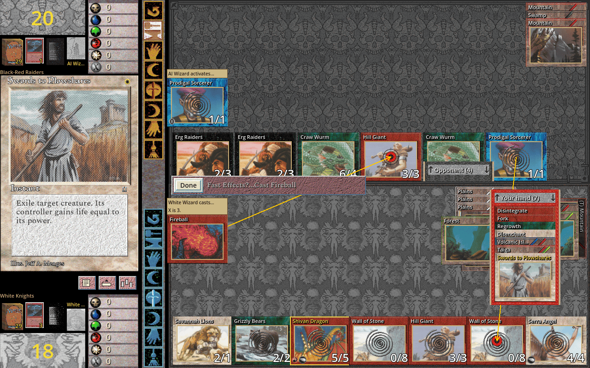
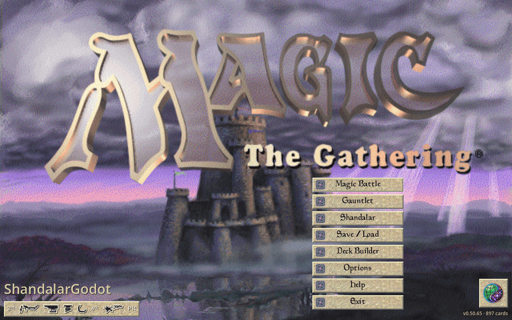
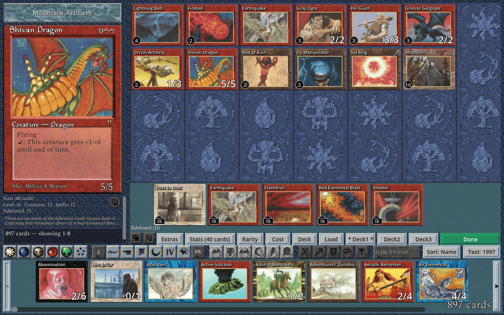
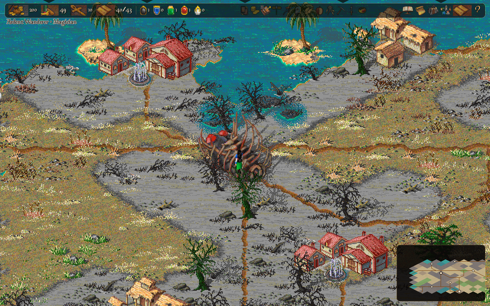

# ShandalarGodot

  

> This project is a love letter to MicroProse MTG: to preserve that special
> 90s Shandalar feeling — the feel of playing early Magic, up to Fourth
> Edition, Alliances, and maybe Fifth — while still going for
> quality-of-life improvements, a modern spin on the gameplay, and the
> tools to go with it.
>
> The key is in the limitations. A specific, finite spell library is
> something you can get creative with, instead of losing time to an
> ever-widening card pool and its obsolescence. It can be fun, it can be
> creative, and — would you believe it? — it can even be relaxing. :)
>
> All the best to the players, and to the community for its help with the
> development. Good luck and good health to all!
>
> — b0realis

An open-source, from-scratch remake of MicroProse's 1997 *Magic: The
Gathering* — its duels and its Shandalar adventure — built in GDScript with
Godot. Early Magic, a modern rules engine, and the freedom to keep the game
alive.

## What's in it

- **Shandalar adventure:** a seeded world, towns, trading, quests, roaming
  creatures, sieges, castles and dungeons, through Arzakon and the Hall of Fame.
  Campaign rules, task tracking, autosaves and a dedicated quicksave slot.
- **Duels:** four non-cheating computer difficulties, hotseat, the Gauntlet,
  resumable matches, Test hands, and 1997 or modern rules. The separate,
  opt-in **Unfair** challenge can see your hand.
- **Deck building:** historic decks, text-list imports, live filters, card
  variants, AutoDeck and [timed Booster Draft](docs/booster-draft.md).
- **LAN play:** hosted duels and [knockout tournaments](docs/sgmanalink-tournaments.md)
  for 2–40 players, computer seats, a host's Master Panel and saved progress.
  Use matching builds and enabled card packs. Public Internet play is future work.

## Screenshots

  
   
  <em>A spell chain in progress during a duel.</em>

  
  
   
  <em>The main menu and the Deck Builder.</em>

  
  
   
  <em>The Shandalar adventure: the world, and a dungeon's board.</em>

  <em>Every screenshot shows the optional original-game skin and card pictures.</em>

## Play

**[Download](https://github.com/b0realis/ShandalarGodot/releases/latest)** ·
**[Getting Started](https://b0realis.github.io/ShandalarGodot/)** ·
**[Report a bug](https://github.com/b0realis/ShandalarGodot/issues)**

Windows, Linux, macOS (Apple Silicon and Intel), Steam Deck, Raspberry Pi 5,
web, Meta Quest 3, and experimental Android ARM64 and ArkOS handhelds.
The release page has setup instructions and SHA-256 checksums;
[handheld](docs/handhelds.md), [Android](docs/android-experimental.md) and
[web](docs/setup-web.txt) guides cover their platform details.

For the adventure, choose **Shandalar → Go test** and create a hero.
It is playable from beginning to end and still being playtested.
The in-game **Help** covers duels, deck building and adventure play.

## Card packs

The **897-card core** grows to **3,093 unique cards** with all nine optional
packs enabled, from DotP Complete and Fallen Empires through the Tempest block,
including both Portal sets. Packs are optional and built locally;
[the pack guide](docs/card-art-and-packs.md) lists every set and builder.

**Campaigns on current main:** tick any of **Packs 2–9** on Embark to add each
pack's own cards to mainland shops, trades and rewards: 20% of random shop and
reward cards per pack, 60% at most, the rest base cards. The first deck and the
creatures' decks stay base cards. All nine packs are available for ordinary
duels and deck building on native platforms. Published downloads may predate
these campaign additions.

## Philosophy

**The limitation is the feature.** Preserve the finite early-Magic pool
and the 1997 feeling. Optional additions should leave that core intact.

**Port, don't invent.** The original game's decisions guide the remake;
quality-of-life changes and rules simplifications are explicit. The
[source history](#provenance) and [fidelity ledger](docs/simplified-cards.md)
keep those choices open to inspection.

**Strong play. Fair information.** Apprentice, Magician, Sorcerer and Wizard
are **non-cheating** opponents: none of them reads your hidden hand, secret
library order or future draws. Each level plays more carefully than the one
below it, and Sorcerer and Wizard also study their own deck, plan their
spells and mana, and search combat ahead. Stronger difficulty means stronger
analysis, never free resources or special rules. See the
[fair-play contract](docs/fair-play.md).

## Art and skins

Choose a `-with-skin` download for the original 1997 look and sounds, or use
the built-in appearance. A separate **2× skin** is available for larger screens.
Use a current skin: older packs may lack the adventure artwork and sounds.

**Card pictures and completed card packs are not bundled.** Every release
includes Python 3.10+ tools to build them. Follow the
[artwork and pack guide](docs/card-art-and-packs.md); no source checkout is needed.

On desktop, keep skin and base-card-art ZIPs in **`skin/`**, and numbered pack
ZIPs in **`cardpacks/`**, beside the executable or Mac app. Leave them zipped.
Use **Options → Skin** or **Options → Card Packs → Add pack…** to import them.
Web supports skin and base artwork in browser storage, but currently has no
numbered-pack installation or LAN multiplayer.

To make a skin from your own 1997 installation, or customize one, see the
[skin importer](tools/mtg_assets.py), [player-file locations](docs/player-files.md)
and [asset catalogue](docs/skin-catalogue.txt).

## DeckLab, AutoDeck and agents

**DeckLab CLI** runs large batches of seeded games in parallel: compare decks,
matchups and gauntlets, then inspect win rates, confidence intervals, charts
and CSV/JSON reports. **AutoDeck CLI** generates candidate decks for deck mining,
whole-deck optimization and experiments that vary a single card or slot.
Generate candidates with AutoDeck, measure them with DeckLab, and repeat.
See the [DeckLab manual](DeckLab/README.md) for commands and examples.

**Play MTG with your favorite agent.** The bundled **MCP server** exposes deck
browsing, deck tools and live duel decisions. The [interface guide](AGENTS.md)
covers setup; the [agent play guide](tools/agentic-playgude-mtg.md) teaches rules,
fair-information play, combat and deck-building strategy.

## Game records: MPN

At the end of a local or LAN duel, **Export MPN** saves its public history.
Open it through **Options → Game records → View past-played games** to browse
a move list or watch recorded states on the duel table. Hidden hands and
library order stay private; playback does not invent unrecorded details.

**Magic Public Notation 0.1** is a proposed open format, independent of this
engine. See the [player guide](docs/mpn-v0.1.md),
[specification](docs/mpn-specification.md), [move-list format](docs/mpn-move-list.md)
and [examples](docs/mpn-examples/). Other implementations and feedback are welcome.

## Next

Adventure polish; Commander and larger formats;
Internet hosting and discovery, booster-draft tournaments and **MElo** community
ranking. Internet services and ranking are parked until resources allow.
Networking and backend contributors are especially welcome.

See the [roadmap](docs/ROADMAP.md#major-features-for-the-future) and
[card-pack authoring guide](docs/adding-card-packs.md).

## Build and contribute

Use **Godot 4.7.2**. Start with the combined
[development and contribution guide](CONTRIBUTING.md) for setup and focused tests;
[release builds](docs/release-builds.md) require export templates.
The [architecture](docs/ARCHITECTURE.md) and [code map](docs/CODE_MAP.md)
explain the source. Bug reports should include platform, version, decks and
seed where available.

## Provenance

The 1997 manual, help and original files guide the remake; decompilations
help verify their behavior. s30, mage-go, Manalink and Forge inform the
implementation; Scryfall supplies card data. Intentional changes are labeled
in code. [Detailed source audits](https://github.com/b0realis/ShandalarGodot/blob/04305db4599868acdcc8c84b698982188c9e4030/Provenance.md)
remain in Git history; [asset credits](game/art/README.md) and third-party
licences stay with the files.

## Thanks

Thank you to **Godot and GUT**, **MicroProse**, the **Shandalar and Manalink
community**, **[SlightlyMagic](https://www.slightlymagic.net/)** and **The Dojo**;
to **Ben Prew** and the [s30](https://github.com/benprew/s30),
[mage-go](https://github.com/benprew/mage-go) and
[mp_pic_tools](https://github.com/benprew/mp_pic_tools) contributors;
to [Forge](https://github.com/Card-Forge/forge), Scryfall, the artists, and
everyone who tested, documented or preserved this game.

Have fun, build something unexpected, and enjoy the duels.
**All the best, good luck and good health to every player!**

## Licence

Code and project-created assets: **[GPL-3.0](LICENSE)**.
Third-party components and fonts retain their own licences; see the
[asset inventory](game/art/README.md) and [provenance](#provenance).

Every font shipped with the game is an open-source font under the
[SIL Open Font License 1.1](game/art/fonts/OFL.txt): Spectral for the text
and Open Sans, Godot's built-in face. The 1997 title lettering appears only
when you install the skin from your own copy of the original game.

## Legal

*Magic: The Gathering* is a trademark of Wizards of the Coast LLC.
This is an unaffiliated, non-commercial fan project. The original skin and
card pictures are separate from the source-code licence and remain the
property of their respective owners.
